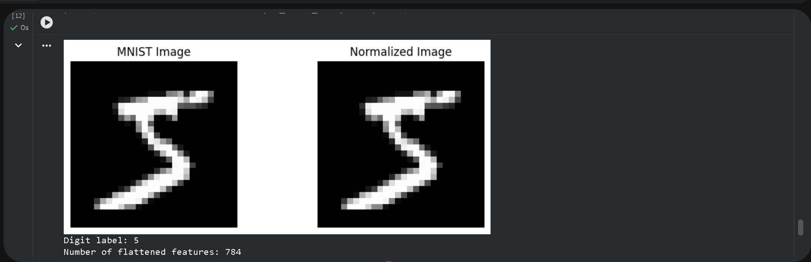

# MNIST Data Loading and Preprocessing

A Python-based project focused on loading, exploring, and preprocessing the MNIST handwritten digit dataset for machine learning workflows.

## Project Overview

This project demonstrates fundamental image data preprocessing techniques using the MNIST handwritten digit dataset. It covers dataset loading, data inspection, quality checks, pixel normalization, flattening, and validation.

The objective is to understand how raw image data is prepared for downstream machine learning tasks.

## Dataset

The MNIST dataset contains grayscale images of handwritten digits from 0 to 9.

- Training images: 60,000
- Testing images: 10,000
- Image dimensions: 28 × 28 pixels
- Number of classes: 10

The dataset is accessed using TensorFlow/Keras.

## Tools and Technologies

- Python
- TensorFlow/Keras
- NumPy
- Matplotlib
- Google Colab
- Jupyter Notebook

## Workflow

1. Download and inspect the dataset archive.
2. Load training images, testing images, and their labels.
3. Explore data shapes, data types, pixel ranges, and label distribution.
4. Check for missing or invalid values.
5. Normalize pixel values to the range 0–1.
6. Flatten each image into a 784-feature vector.
7. Validate processed arrays and visualize an example.

## Preprocessing Visualization

The figure compares an MNIST image before and after normalization. Normalization rescales pixel values while preserving the digit's visual structure.

## Results and Validation

| Check | Expected result |
|---|---|
| Training images | 60,000 |
| Testing images | 10,000 |
| Original image dimensions | 28 × 28 |
| Normalized pixel range | 0–1 |
| Normalized data type | float32 |
| Flattened training shape | 60,000 × 784 |
| Flattened testing shape | 10,000 × 784 |

The notebook includes validation checks for array shapes, data types, finite values, pixel ranges, and label counts.

## How to Run

1. Open the notebook using the Google Colab link above.
2. Run the cells sequentially from beginning to end.
3. Allow the dataset to download and load.
4. Review the validation outputs and visualization.

## Project Scope

This project focuses on data loading, exploration, normalization, flattening, and validation. Model training and predictive performance evaluation are not included.

## Author

Nandani Rana
